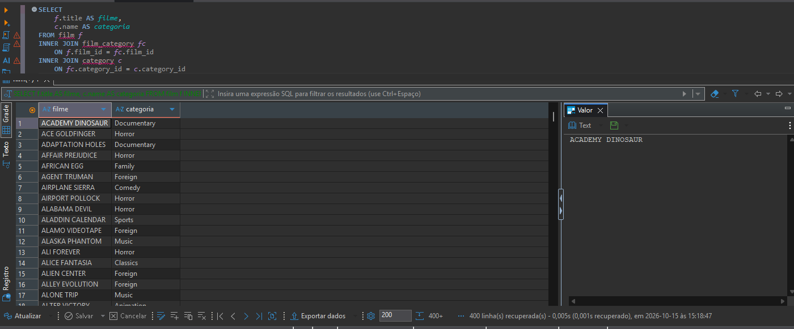
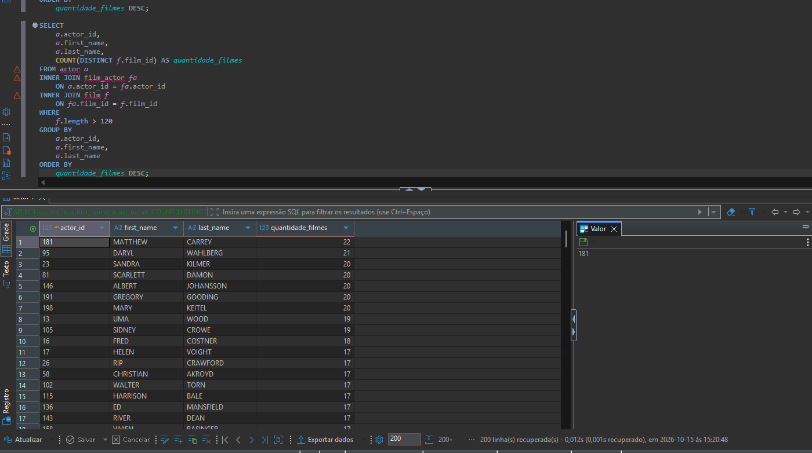
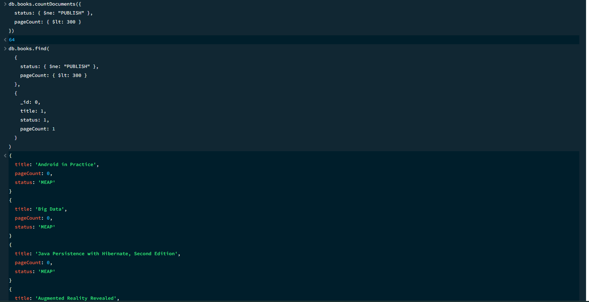
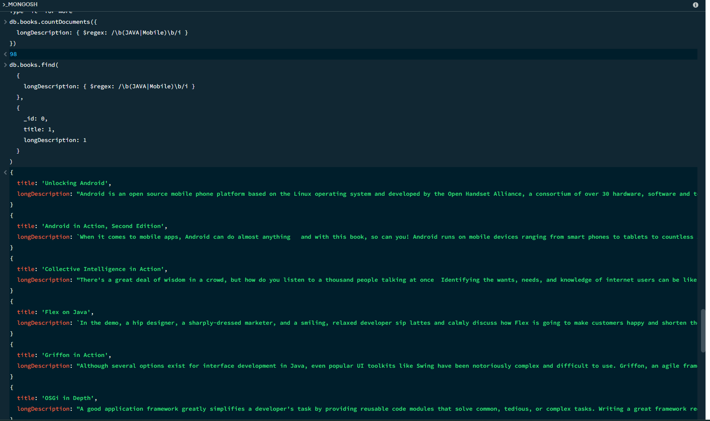

# Módulo 32 - Banco de Dados SQL/NoSQL

Exercício do módulo 32 do curso de Engenharia de Qualidade de Software da EBAC.

## Estrutura

### SQL

Consultas realizadas utilizando o banco Sakila:

- listagem de filmes e suas respectivas categorias;
- listagem de atores e quantidade de filmes em que participaram;
- identificação de atores que participaram de filmes com mais de 120 minutos;
- contagem dos resultados obtidos nas consultas.

Arquivos:

- `SQL/exercicio_1.sql`
- `SQL/exercicio_2.sql`

#### Resultados obtidos

| Consulta | Resultado |
| --- | ---: |
| Filmes e categorias | 1.000 registros |
| Atores e quantidade de filmes | 200 atores |
| Atores em filmes com mais de 120 minutos | 200 atores |

#### Evidências

**1. Filmes e categorias**

**2. Atores e quantidade de filmes**

**3. Atores em filmes com mais de 120 minutos**

---

### NoSQL

Consultas realizadas utilizando o arquivo `books.json` no MongoDB.

Na reexecução utilizada para gerar as evidências, a coleção continha **394 documentos**.

Foram realizadas consultas para:

- livros não publicados com menos de 300 páginas;
- livros com `MongoDB` ou `SQL Server` no título;
- livros com ISBN iniciado por `18`;
- livros com `JAVA` ou `Mobile` na descrição;
- contagem dos resultados obtidos nas consultas.

Arquivos:

- `NoSQL/exercicio_1.nosql`
- `NoSQL/exercicio_2.nosql`

#### Resultados obtidos

| Consulta | Resultado |
| --- | ---: |
| Livros não publicados com menos de 300 páginas | 64 livros |
| Livros com `MongoDB` ou `SQL Server` no título | 10 livros |
| Livros com ISBN iniciado por `18` | 44 livros |
| Livros com `JAVA` ou `Mobile` na descrição | 98 livros |

#### Evidências

**1. Livros não publicados com menos de 300 páginas**

**2. Livros com `MongoDB` ou `SQL Server` no título**

**3. Livros com ISBN iniciado por `18`**

**4. Livros com `JAVA` ou `Mobile` na descrição**

